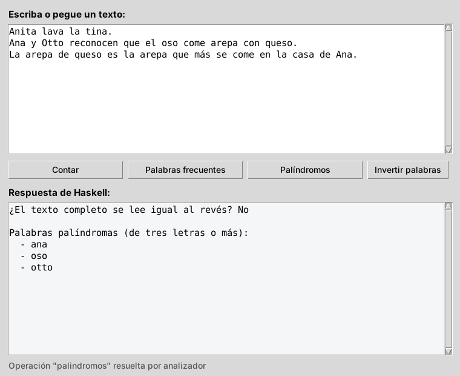

# Nivel 1 (fácil): Analizador de texto

Una ventana hecha en Python donde usted escribe un texto y pulsa un botón. Quien hace el trabajo es un programa en Haskell, que puede hacer cuatro cosas:

- **Contar** líneas, palabras y letras.
- Encontrar las **palabras más frecuentes**.
- Detectar **palíndromos**: palabras que se leen igual al derecho y al revés, como "oso".
- **Invertir** el orden de las palabras de cada línea.



*La captura se tomó en Linux; en Windows los botones y las letras se ven un poco distintos.*

---

## Antes de empezar

Abra cmd (tecla Windows, escriba `cmd`, Enter) y escriba estos dos comandos, uno por uno:

```cmd
py --version
ghc --version
```

Los dos deben responder con un número de versión. **Si alguno dice `is not recognized`, primero siga el README general** (el de la carpeta de arriba), partes 1 y 2.

---

## Paso 1. Abrir cmd en la carpeta de este proyecto

1. Abra el Explorador de archivos y entre a la carpeta `1 - Facil - Analizador de texto` (la que contiene este README).
2. Haga clic en la **barra de direcciones** (arriba, donde aparece la ruta de la carpeta).
3. Borre lo que hay, escriba `cmd` y pulse **Enter**.

Se abre una ventana negra. El renglón donde se escribe debe **terminar en el nombre de la carpeta**:

```
C:\...\1 - Facil - Analizador de texto>
```

Si termina en otra cosa (por ejemplo `C:\Users\suNombre>`), está en otra carpeta y los comandos siguientes no van a funcionar. Repita este paso.

## Paso 2. Activar las tildes en cmd

Escriba y pulse Enter:

```cmd
chcp 65001
```

Debe responder `Active code page: 65001`. Sin esto, cmd muestra `L├¡neas` en lugar de `Líneas`. **Repita este paso cada vez que abra un cmd nuevo.**

## Paso 3. Compilar el programa de Haskell

Compilar significa convertir el código de Haskell (`.hs`) en un programa que Windows puede ejecutar (`.exe`). Escriba:

```cmd
ghc -O2 -outputdir build Main.hs -o analizador
```

Debe aparecer:

```
[1 of 3] Compiling Analisis         ( Analisis.hs, build\Analisis.o )
[2 of 3] Compiling Main             ( Main.hs, build\Main.o )
[3 of 3] Linking analizador.exe
```

Ahora en la carpeta hay un archivo nuevo, **`analizador.exe`**, y una carpeta `build` con archivos intermedios que puede ignorar.

Qué significa cada parte del comando:

| Parte | Significado |
|---|---|
| `ghc` | El compilador de Haskell. |
| `-O2` | Le pide que optimice el programa para que corra más rápido. |
| `-outputdir build` | Guarda los archivos intermedios (`.hi` y `.o`) en la carpeta `build`, para no llenar esta de archivos. |
| `Main.hs` | El archivo principal. GHC encuentra solo los demás (`Analisis.hs`). |
| `-o analizador` | El nombre del programa que se genera: `analizador.exe`. |

**Solo hay que volver a compilar si cambia algún archivo `.hs`.**

## Paso 4. Probar Haskell solo, sin la ventana

Antes de usar la ventana, compruebe que Haskell responde bien por su cuenta. **Si algo falla aquí, el problema está en Haskell, no en la ventana.**

En estos comandos, `<` significa "dale al programa el contenido de este archivo". El archivo `ejemplo.txt` ya está en la carpeta.

**4.1. Contar**

```cmd
analizador.exe contar < ejemplo.txt
```

Debe aparecer:

```
Líneas:                  4
Palabras:                41
Letras:                  140
Caracteres (sin saltos): 181
Longitud media:          3,4 letras por palabra
```

**4.2. Palabras más frecuentes**

```cmd
analizador.exe frecuentes < ejemplo.txt
```

Debe aparecer (las primeras líneas):

```
1. arepa (3 veces)
2. come (2 veces)
3. queso (2 veces)
4. anita (1 vez)
...
```

Solo se cuentan palabras de cuatro letras o más. Si no, "de", "la" y "que" ganarían siempre.

**4.3. Palíndromos**

```cmd
analizador.exe palindromos < ejemplo.txt
```

Debe aparecer:

```
¿El texto completo se lee igual al revés? No

Palabras palíndromas (de tres letras o más):
  - ana
  - oso
  - otto
```

**4.4. Invertir**

```cmd
analizador.exe invertir < ejemplo.txt
```

Debe aparecer:

```
tina. la lava Anita
queso. con arepa come oso el que reconocen Otto y Ana
...
```

**4.5. Un error a propósito**

Escriba una operación que no existe:

```cmd
analizador.exe nada
```

Debe aparecer:

```
Operación desconocida: nada
```

Ahora pregunte cómo terminó el programa:

```cmd
echo %errorlevel%
```

Debe aparecer `1`. **Ese 1 es el "código de salida".** Un programa que termina bien devuelve 0 y uno que falla devuelve otro número. Así es como la ventana de Python se entera de que Haskell tuvo un problema.

## Paso 5. Abrir la ventana

Escriba:

```cmd
py app.py
```

Se abre la ventana de la captura de arriba, con un texto de ejemplo ya escrito.

1. Pulse **Contar**: abajo aparece el mismo informe del paso 4.1.
2. Pulse **Palíndromos**, **Palabras frecuentes** e **Invertir palabras**.
3. Borre el texto con **Limpiar**, escriba uno suyo (con tildes y ñ) y vuelva a probar.

Mientras la ventana está abierta, cmd queda esperando. Al cerrar la ventana, cmd vuelve a aceptar comandos.

---

## Si algo sale mal

| Lo que pasa | Por qué | Qué hacer |
|---|---|---|
| `'ghc' is not recognized...` o `'py' is not recognized...` | Falta instalar algo, o el cmd se abrió antes de instalarlo. | Cierre cmd y ábralo de nuevo. Si sigue, vea el README general. |
| `error: Can't find Main.hs` o `The system cannot find the file specified` | cmd no está en la carpeta del proyecto. | Repita el paso 1. |
| `'analizador.exe' is not recognized...` | No se ha compilado, o la compilación falló. | Repita el paso 3 y lea si apareció algún error. |
| Aparece `L├¡neas` en vez de `Líneas` | La consola no está en UTF-8. | Escriba `chcp 65001` (paso 2). En la ventana de Python no pasa. |
| La ventana dice **"Falta el ejecutable"** | `analizador.exe` no está en la misma carpeta que `app.py`. | Compile en esta carpeta (paso 3). |
| `py app.py` no hace nada o abre la Microsoft Store | Python no está bien instalado. | Vea el README general, parte 1.4. |
| `No module named tkinter` | Python se instaló sin Tkinter. | Vea el README general, parte 1.4. |
| Se abre y se cierra una consola negra en cada clic | Windows muestra la consola del `.exe`. | No debería pasar con este `app.py` (lo evita `CREATE_NO_WINDOW`). Si modificó `app.py`, revise esa línea. |

---

## Si usa PowerShell en vez de cmd

Los comandos cambian un poco:

| En cmd | En PowerShell |
|---|---|
| `chcp 65001` | `$OutputEncoding = [Console]::OutputEncoding = [Text.UTF8Encoding]::new()` |
| `analizador.exe contar < ejemplo.txt` | `Get-Content ejemplo.txt -Encoding UTF8 \| .\analizador.exe contar` |
| `echo %errorlevel%` | `echo $LASTEXITCODE` |
| `analizador.exe nada` | `.\analizador.exe nada` (en PowerShell los programas de la carpeta llevan `.\` adelante) |

Compilar (`ghc ...`) y abrir la ventana (`py app.py`) se escriben igual.

---

## Cómo funciona por dentro

### El reparto del trabajo

```
+---------------- Python (app.py) ----------------+
|  Ventana Tkinter: cuadro de texto y botones     |
+-------------------------------------------------+
        |                              ^
        |  argumento: "palindromos"    |  stdout: el informe
        |  stdin:     el texto         |  stderr: el error, si lo hay
        v                              |  código de salida: 0 bien, 1 error
+---------------- analizador.exe (Haskell) -------+
|  Main.hs      lee, escoge la operación, imprime |
|  Analisis.hs  funciones puras que calculan      |
+-------------------------------------------------+
```

Todo programa de consola tiene tres "tubos" de comunicación:

- la **entrada estándar** (*stdin*), por donde recibe datos;
- la **salida estándar** (*stdout*), por donde entrega el resultado;
- la **salida de errores** (*stderr*), por donde avisa problemas.

Además devuelve un **código de salida**. En el paso 4 usted usó esos tubos a mano: `<` llenaba el stdin, la pantalla mostraba el stdout, y `%errorlevel%` mostraba el código. **La ventana de Python hace exactamente lo mismo**, solo que sin que usted lo vea.

Cada clic en un botón abre el programa de Haskell, le da el texto, espera la respuesta, y el programa se cierra.

### Los archivos

| Archivo | Qué contiene |
|---|---|
| `Analisis.hs` | La lógica: funciones puras que reciben un texto y devuelven el informe. |
| `Main.hs` | El programa de consola: lee la operación y el texto, llama a la función que corresponde e imprime el resultado. |
| `app.py` | La ventana en Python. |
| `ejemplo.txt` | Un texto de prueba. |

### Haskell: la lógica es pura

`Analisis.hs` no imprime nada ni lee archivos. Cada operación es una función `String -> String`.

La que parte el texto en palabras es **recursiva**: salta lo que no es letra, toma una palabra y se vuelve a llamar con el resto del texto.

```haskell
extraerPalabras :: String -> [String]
extraerPalabras texto =
  case dropWhile (not . isAlpha) texto of
    ""    -> []
    resto -> let (palabra, siguiente) = span isAlpha resto
             in palabra : extraerPalabras siguiente
```

Las **guardas** quitan la tilde de cada vocal, para que "Árbol" y "arbol" cuenten como la misma palabra:

```haskell
sinTilde c
  | c `elem` "áàä" = 'a'
  | c `elem` "éèë" = 'e'
  ...
  | otherwise      = c
```

### Haskell: `Main.hs` conecta la lógica con el exterior

```haskell
operaciones :: [(String, String -> String)]
operaciones =
  [ ("contar",      informeConteo)
  , ("frecuentes",  informeFrecuentes)
  , ("palindromos", informePalindromos)
  , ("invertir",    informeInvertir) ]
```

Esta lista une la palabra que llega desde Python (`"contar"`) con la función pura que la resuelve (`informeConteo`). Si la palabra no está en la lista, el programa escribe el motivo en **stderr** y termina con **código 1**. Es lo que usted vio en el paso 4.5.

La primera línea de `main` es importante en Windows:

```haskell
mapM_ (`hSetEncoding` utf8) [stdin, stdout, stderr]
```

Sin ella, la ñ y las tildes llegan dañadas.

### Python: una sola función habla con Haskell

```python
resultado = subprocess.run(
    [str(EJECUTABLE), operacion],   # equivale a escribir: analizador.exe palindromos
    input=texto,                    # lo que Haskell leerá por stdin
    capture_output=True,            # guarda stdout y stderr en vez de mostrarlos
    text=True, encoding="utf-8",    # debe coincidir con el utf8 de Haskell
    timeout=10,                     # si tarda más de 10 s, se cancela
    creationflags=SIN_CONSOLA)      # en Windows, no abre una consola negra
if resultado.returncode != 0:       # el código de salida del paso 4.5
    raise RuntimeError(resultado.stderr.strip())
return resultado.stdout
```

Todo lo demás de `app.py` es Tkinter: un cuadro de texto, cuatro botones y un cuadro para la respuesta.

---

## Ejercicios para practicar

1. Agregue la operación `vocales`, que cuente cuántas veces aparece cada vocal sin importar la tilde. Necesita tres cambios:
   - una función nueva en `Analisis.hs`;
   - un renglón en `operaciones` de `Main.hs`;
   - un botón en `app.py`.

   Pruébela primero en cmd (`analizador.exe vocales < ejemplo.txt`) y después en la ventana.
2. En `informeFrecuentes`, el mínimo de cuatro letras está fijo en el código. Haga que llegue como segundo argumento, por ejemplo `analizador.exe frecuentes 5 < ejemplo.txt`.
3. Haga que el texto completo cuente como palíndromo aunque tenga números ("2002").
4. En `Main.hs`, dentro de la función `fallar`, cambie `ExitFailure 1` por `ExitSuccess`. Compile y pruebe en la ventana una operación inválida. Explique qué pasa y por qué el código de salida es importante.
