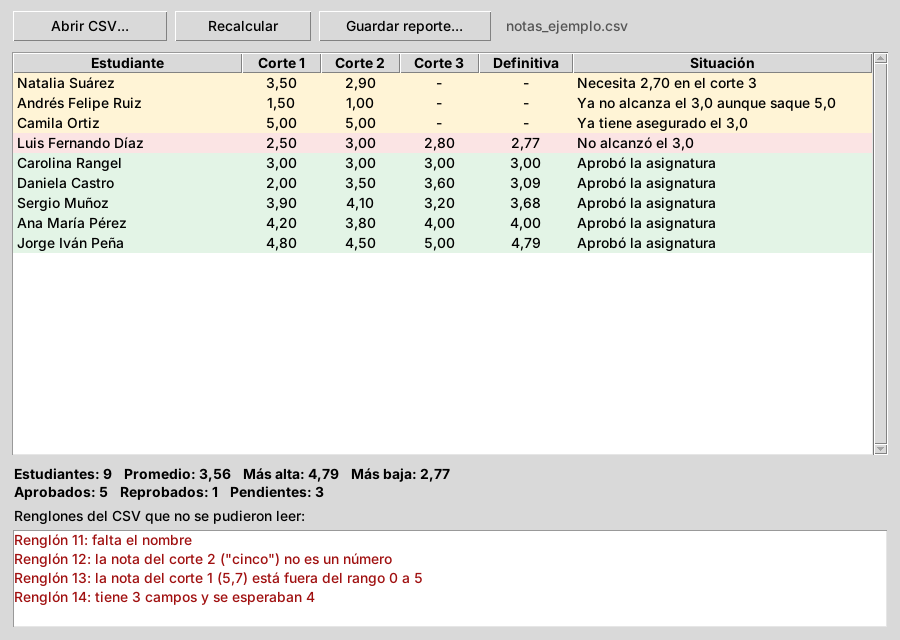

# Nivel 2 (intermedio): Notas de un curso

Una ventana en Python abre un archivo con las notas de los tres cortes de un curso. Un programa en Haskell revisa cada renglón y hace el trabajo:

- Calcula la **definitiva** de cada estudiante (30 % + 30 % + 40 %).
- Dice quién **aprobó** y quién **reprobó**.
- Para quien aún no tiene la nota del corte 3, calcula **cuánto necesita** para aprobar.
- Reporta los renglones del archivo que **tienen errores**, sin detenerse por ellos.
- Escribe un **reporte** en un archivo de texto.



*La captura se tomó en Linux; en Windows los botones y las letras se ven un poco distintos.*

**Haga primero el nivel 1.** Este README da por sabido cómo abrir cmd en una carpeta, qué es compilar y qué es el código de salida.

---

## Antes de empezar

En cmd, compruebe que tiene las dos herramientas:

```cmd
py --version
ghc --version
```

Si alguna dice `is not recognized`, siga el README general (carpeta de arriba).

---

## Paso 1. Abrir cmd en la carpeta de este proyecto

1. En el Explorador de archivos, entre a la carpeta `2 - Intermedio - Notas de un curso`.
2. Haga clic en la barra de direcciones, escriba `cmd` y pulse Enter.
3. Compruebe que el renglón de cmd termina en `2 - Intermedio - Notas de un curso>`.

Si viene del nivel 1 y ya tiene cmd abierto en esa carpeta, puede pasar con este comando:

```cmd
cd "..\2 - Intermedio - Notas de un curso"
```

## Paso 2. Activar las tildes

```cmd
chcp 65001
```

## Paso 3. Compilar

```cmd
ghc -O2 -outputdir build Main.hs -o notas
```

Debe aparecer:

```
[1 of 3] Compiling Notas            ( Notas.hs, build\Notas.o )
[2 of 3] Compiling Main             ( Main.hs, build\Main.o )
[3 of 3] Linking notas.exe
```

Ahora en la carpeta está **`notas.exe`**.

## Paso 4. Mirar el archivo de notas

El archivo de prueba es `notas_ejemplo.csv`. Para verlo en cmd:

```cmd
type notas_ejemplo.csv
```

Debe aparecer:

```
nombre;corte1;corte2;corte3
Ana María Pérez;4,2;3,8;4,0
Luis Fernando Díaz;2,5;3,0;2,8
Carolina Rangel;3,0;3,0;3,0
...
Natalia Suárez;3,5;2,9;
...
;4,0;4,0;4,0
Mateo Gómez;4,5;cinco;4,0
Valentina Rojas;5,7;4,0;3,0
Julián Herrera;3,0;4,0
```

Cómo está armado el archivo:

- **Primer renglón:** el encabezado. El programa lo salta.
- **Cada renglón siguiente:** un estudiante, con cuatro datos separados por **punto y coma** (`;`): nombre, corte 1, corte 2 y corte 3.
- **Las notas** usan **coma decimal** (`4,2`), como en Colombia. También se acepta punto (`4.2`).
- **Corte 3 vacío** (`Natalia Suárez;3,5;2,9;`): el estudiante todavía no ha presentado el corte 3.
- **Los últimos cuatro renglones tienen errores a propósito**, para ver cómo los maneja el programa:

| Renglón | Error |
|---|---|
| `;4,0;4,0;4,0` | Falta el nombre. |
| `Mateo Gómez;4,5;cinco;4,0` | "cinco" no es un número. |
| `Valentina Rojas;5,7;4,0;3,0` | 5,7 es mayor que 5. |
| `Julián Herrera;3,0;4,0` | Tiene tres datos en vez de cuatro. |

El archivo se puede abrir y editar en Excel o en el Bloc de notas.

## Paso 5. Probar Haskell solo, sin la ventana

**5.1. Calcular**

```cmd
notas.exe calcular notas_ejemplo.csv
```

Fíjese en la diferencia con el nivel 1: aquí **no** se usa `<`. Se le da a Haskell **el nombre del archivo** y Haskell lo abre por su cuenta.

Debe aparecer (las primeras líneas):

```
ERR	11	falta el nombre
ERR	12	la nota del corte 2 ("cinco") no es un número
ERR	13	la nota del corte 1 (5,7) está fuera del rango 0 a 5
ERR	14	tiene 3 campos y se esperaban 4
EST	2	Ana María Pérez	4.20	3.80	4.00	4.00	APROBO	Aprobó la asignatura
EST	3	Luis Fernando Díaz	2.50	3.00	2.80	2.77	REPROBO	No alcanzó el 3,0
...
RES	9	3.56	4.79	2.77	5	1	3
```

**Esta respuesta no está pensada para personas, sino para que la lea la ventana de Python.** Cada renglón empieza con una etiqueta:

| Etiqueta | Significa | Datos que siguen, en orden |
|---|---|---|
| `ERR` | Un renglón del archivo con error. | número de renglón, motivo |
| `EST` | Un estudiante válido. | renglón, nombre, corte 1, corte 2, corte 3, definitiva, estado, explicación |
| `RES` | El resumen del curso. | estudiantes, promedio, nota más alta, nota más baja, aprobados, reprobados, pendientes |

Los datos van separados por **tabulador** (en pantalla se ve como un espacio largo). Se usa el tabulador porque un nombre puede tener espacios o comas, pero nunca un tabulador. Los números van con **punto** decimal y un guion (`-`) significa "no hay dato".

A este acuerdo sobre cómo se escriben las respuestas se le llama **protocolo**.

**5.2. Escribir el reporte**

```cmd
notas.exe reporte notas_ejemplo.csv reporte.txt
```

Debe aparecer:

```
Reporte guardado en reporte.txt
```

Ahora véalo:

```cmd
type reporte.txt
```

Debe aparecer:

```
REPORTE DE NOTAS DEL CURSO
Pesos: corte 1 30 %, corte 2 30 %, corte 3 40 %

Estudiante                    C1     C2     C3     Def.   Situación
------------------------------------------------------------------------------------------------
Ana María Pérez               4,20   3,80   4,00   4,00   Aprobó la asignatura
Luis Fernando Díaz            2,50   3,00   2,80   2,77   No alcanzó el 3,0
...
Natalia Suárez                3,50   2,90   -      -      Necesita 2,70 en el corte 3
...
```

Este sí es para personas. Lo escribió Haskell directamente en el archivo `reporte.txt`, que también puede abrir con el Bloc de notas.

**5.3. Errores a propósito**

Un archivo que no existe:

```cmd
notas.exe calcular no_existe.csv
echo %errorlevel%
```

Debe aparecer:

```
No se pudo leer el archivo: no_existe.csv
2
```

Una orden mal escrita:

```cmd
notas.exe
echo %errorlevel%
```

Debe aparecer:

```
Uso: notas calcular <archivo.csv>  |  notas reporte <archivo.csv> <salida.txt>
1
```

**Cada tipo de error tiene su propio código:** 1 si la orden está mal escrita, 2 si hay un problema con un archivo. Así la ventana sabe qué pasó.

## Paso 6. Abrir la ventana

```cmd
py app.py
```

La ventana carga sola `notas_ejemplo.csv`. Compruebe lo siguiente:

1. **La tabla** muestra nueve estudiantes con colores:
   - **verde**: aprobó;
   - **rojo**: reprobó;
   - **amarillo**: pendiente, es decir, sin nota del corte 3.
2. **El resumen** de abajo dice: Estudiantes 9, Promedio 3,56, Aprobados 5, Reprobados 1, Pendientes 3.
3. **La lista roja** muestra los cuatro renglones con error.
4. **Haga clic en el encabezado "Definitiva":** la tabla se ordena por esa columna. Otro clic invierte el orden.
5. **Pulse "Guardar reporte...":** escoja dónde guardarlo y ábralo después con el Bloc de notas.
6. **Pruebe con su propio archivo:**
   - abra `notas_ejemplo.csv` en Excel, cambie algunas notas y guárdelo como **CSV (delimitado por comas)**;
   - en la ventana pulse **Recalcular**.

---

## Si algo sale mal

| Lo que pasa | Por qué | Qué hacer |
|---|---|---|
| Todos los renglones dicen "tiene 1 campos y se esperaban 4" | El archivo usa comas (`,`) en lugar de punto y coma (`;`) para separar. | Ábralo en el Bloc de notas y revise el separador. En Excel con la configuración regional de Colombia, "CSV (delimitado por comas)" normalmente guarda con punto y coma. |
| "No se pudo leer el archivo", pero el archivo sí existe | Está abierto en Excel, que lo bloquea. | Cierre Excel y pulse **Recalcular**. |
| El primer nombre aparece con un carácter raro al inicio | Excel agregó un carácter invisible (BOM) al guardar como "CSV UTF-8". | El programa ya lo quita. Si lo ve, avise: revise `dropWhile (== '\xFEFF')` en `Notas.hs`. |
| La ventana dice **"Renglón inesperado de Haskell"** | Alguien cambió el formato de respuesta en `Main.hs` y no en `app.py`, o al revés. | Compare los datos de `respuestaCalcular` en `Main.hs` con la función `interpretar` en `app.py`. |
| La ventana dice **"Falta el ejecutable"** | No está `notas.exe` en la carpeta. | Compile (paso 3). |

Los problemas de tildes, de `is not recognized` o de Python se resuelven igual que en el nivel 1.

---

## Si usa PowerShell en vez de cmd

| En cmd | En PowerShell |
|---|---|
| `chcp 65001` | `[Console]::OutputEncoding = [Text.UTF8Encoding]::new()` |
| `notas.exe calcular notas_ejemplo.csv` | `.\notas.exe calcular notas_ejemplo.csv` |
| `type reporte.txt` | `Get-Content reporte.txt -Encoding UTF8` |
| `echo %errorlevel%` | `echo $LASTEXITCODE` |

---

## Cómo funciona por dentro

### El reparto del trabajo

```
+------------------------- Python (app.py) --------------------------+
|  Abre el CSV, muestra la tabla, el resumen y los errores.           |
|  NO calcula ninguna nota.                                           |
+---------------------------------------------------------------------+
     |                                         ^
     |  notas.exe calcular notas.csv           |  renglones etiquetados (stdout)
     |  notas.exe reporte notas.csv rep.txt    |  mensaje de error (stderr)
     v                                         |  código de salida 0, 1 o 2
+---------------------- notas.exe (Haskell) --------------------------+
|  Main.hs   lee y escribe archivos, arma las respuestas              |
|  Notas.hs  valida, calcula definitivas, estados y el resumen (puro) |
+---------------------------------------------------------------------+
```

### Los archivos

| Archivo | Qué contiene |
|---|---|
| `Notas.hs` | Tipos, lectura y validación del CSV, cálculos y resumen. Todo puro: no lee archivos ni imprime. |
| `Main.hs` | Las órdenes `calcular` y `reporte`, la lectura y escritura de archivos y los códigos de salida. |
| `app.py` | La ventana en Python. |
| `notas_ejemplo.csv` | Trece renglones de prueba; cuatro tienen errores a propósito. |

Los porcentajes de cada corte están en un solo lugar, `pesos` en `Notas.hs`. Si los cambia ahí y vuelve a compilar, cambia todo el programa.

### `Either`: revisar un dato sin detener el programa

```haskell
leerNota :: String -> String -> Either String Double
leerNota cual texto =
  case reads (map comaAPunto texto) :: [(Double, String)] of
    [(nota, "")]
      | nota >= 0 && nota <= 5 -> Right nota
      | otherwise              -> Left ("... está fuera del rango 0 a 5")
    _ -> Left ("... no es un número")
```

Un `Either` es una caja que trae una de dos cosas:

- **`Right`** trae el valor correcto (la nota);
- **`Left`** trae la explicación del error.

En `leerRenglon`, el bloque `do` revisa las tres notas en orden. **Si cualquiera da `Left`, el renglón completo es ese `Left`** y no se calcula nada más de ese estudiante. Al final, `leerCurso` separa los errores de los estudiantes válidos con dos listas por comprensión:

```haskell
( [ e | Left e <- resultados ], [ x | Right x <- resultados ] )
```

Por eso, en el paso 5.1, los cuatro renglones malos aparecen como `ERR` y los otros nueve se calculan normalmente.

### `Maybe`: una nota que todavía no existe

```haskell
corte3 :: Maybe Double           -- Nothing si el corte 3 está vacío

definitiva e = do
  c3 <- corte3 e                 -- si es Nothing, la definitiva también es Nothing
  ...
```

Un `Maybe` es una caja que puede venir llena (`Just 4.0`) o vacía (`Nothing`). Si el corte 3 está vacío, la definitiva también queda vacía, y por eso aparece `-` en la tabla.

### El redondeo de Haskell no es el del colegio

En Haskell, `round 2.5` da `2`, no `3`: redondea al número **par** más cercano. Para que 2,995 quede en 3,00, la función `redondear2` usa `floor (x * 100 + 0.5)`.

Además, la definitiva se redondea **antes** de compararla con 3,0. Las computadoras calculan con decimales aproximados, y `0.3*3 + 0.3*3 + 0.4*3` puede dar 2,9999999. Sin ese redondeo, alguien con 3,00 quedaría reprobado.

### Archivos con tildes

```haskell
setLocaleEncoding utf8                          -- readFile y writeFile en UTF-8
mapM_ (`hSetEncoding` utf8) [stdin, stdout, stderr]
```

En Windows, los archivos no se leen en UTF-8 a menos que se pida. Sin esas dos líneas, "Pérez" se leería mal.

### Python: leer el protocolo

```python
for renglon in salida.splitlines():
    campos = renglon.split("\t")              # separa por tabulador
    if campos[0] == "EST" and len(campos) == 9: ...
    elif campos[0] == "ERR" and len(campos) == 3: ...
    elif campos[0] == "RES" and len(campos) == 8: ...
    else:
        raise ValueError(f"Renglón inesperado de Haskell: {renglon!r}")
```

Cada etiqueta lleva siempre la misma cantidad de datos. Si alguien cambia el formato en Haskell y olvida cambiarlo en Python, esa comprobación lo descubre enseguida, en vez de mostrar datos en la columna equivocada.

---

## Ejercicios para practicar

1. Agregue al resumen la **desviación estándar** de las definitivas. Hay que tocar cuatro lugares:
   - `Resumen` y `resumir` en `Notas.hs`;
   - el renglón `RES` en `Main.hs`;
   - `interpretar` y `mostrar_resumen` en `app.py`.

   Pruebe primero en cmd que el renglón `RES` trae el dato nuevo.
2. Haga que los pesos lleguen como argumentos: `notas.exe calcular notas_ejemplo.csv 30 30 40`. Valide en Haskell que sumen 100; si no, termine con código 1.
3. Agregue la orden `notas.exe buscar notas_ejemplo.csv ana`. Debe devolver solo los estudiantes cuyo nombre contenga ese texto, sin importar mayúsculas ni tildes. Después agregue en la ventana un cuadro de búsqueda que la use.
4. Agregue un estudiante con nota `3,0` en los tres cortes y otro con `2,99`, `3,0` y `3,0`. Calcule a mano qué definitiva debe dar cada uno y compruebe que el programa coincide.
