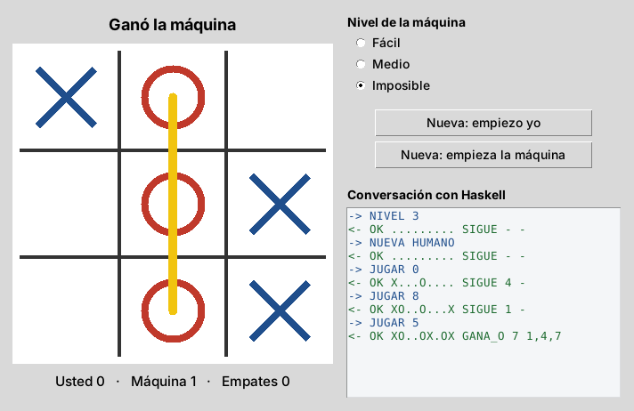

# Nivel 3 (difícil): Triqui contra la máquina

Un triqui en el que usted juega con **X** contra la computadora, que juega con **O**. La ventana está hecha en Python. La máquina "piensa" en Haskell con un algoritmo llamado **minimax**, y tiene tres niveles:

| Nivel | Cómo juega |
|---|---|
| Fácil | Solo ve si puede ganar en la jugada siguiente. |
| Medio | Ve venir algunas amenazas. |
| Imposible | Revisa la partida completa: **no pierde nunca**. |

Se comprobó jugando contra el nivel imposible todas las partidas distintas que se le pueden plantear: 613, con todas las respuestas posibles de la persona y empiece quien empiece. La persona no ganó ninguna.



*La captura se tomó en Linux; en Windows los botones y las letras se ven un poco distintos.*

**Haga primero los niveles 1 y 2.** Este README da por sabido cómo abrir cmd en una carpeta, compilar y leer un protocolo.

---

## Qué tiene de diferente este nivel

En los niveles 1 y 2, **cada clic abría el programa de Haskell, este respondía y se cerraba**.

Aquí no puede ser así, porque Haskell tiene que recordar cómo va la partida. Por eso `triqui.exe` se abre **una sola vez**, cuando se abre la ventana, y **se queda abierto conversando con Python** hasta que se cierra la ventana: Python le escribe una orden y Haskell le contesta, una y otra vez.

---

## Antes de empezar

En cmd, compruebe que tiene las dos herramientas:

```cmd
py --version
ghc --version
```

Si alguna dice `is not recognized`, siga el README general (carpeta de arriba).

---

## Paso 1. Abrir cmd en la carpeta de este proyecto

1. En el Explorador de archivos, entre a la carpeta `3 - Dificil - Triqui contra la maquina`.
2. Haga clic en la barra de direcciones, escriba `cmd` y pulse Enter.
3. Compruebe que el renglón de cmd termina en `3 - Dificil - Triqui contra la maquina>`.

Si viene del nivel 2 con cmd abierto, puede pasar con:

```cmd
cd "..\3 - Dificil - Triqui contra la maquina"
```

## Paso 2. Activar las tildes

```cmd
chcp 65001
```

## Paso 3. Compilar

```cmd
ghc -O2 -outputdir build Main.hs -o triqui
```

Debe aparecer:

```
[1 of 3] Compiling Triqui           ( Triqui.hs, build\Triqui.o )
[2 of 3] Compiling Main             ( Main.hs, build\Main.o )
[3 of 3] Linking triqui.exe
```

Aquí `-O2` importa de verdad. Sin optimización, la máquina tarda bastante más en su primera jugada del nivel imposible, porque tiene que revisar cientos de miles de partidas.

## Paso 4. Jugar contra Haskell a mano, sin la ventana

Este paso es el más importante para entender el proyecto. **Usted va a hacer, escribiendo, exactamente lo que después hará la ventana.**

### 4.1. Abrir el programa

```cmd
triqui.exe 2>nul
```

El `2>nul` esconde los mensajes de registro (stderr) para que la pantalla quede limpia; más abajo se explica qué son.

**El programa no muestra nada y se queda esperando.** Es correcto: está esperando que usted le escriba una orden.

### 4.2. Las casillas

El tablero tiene nueve casillas, numeradas del 0 al 8:

```
 0 | 1 | 2
---+---+---
 3 | 4 | 5
---+---+---
 6 | 7 | 8
```

### 4.3. Jugar

Escriba cada orden y pulse Enter. Después de cada una, Haskell contesta un renglón.

| Usted escribe | Haskell contesta | Qué pasó |
|---|---|---|
| `NUEVA HUMANO` | `OK ......... SIGUE - -` | Partida nueva; empieza usted. El tablero está vacío (9 puntos). |
| `JUGAR 4` | `OK O...X.... SIGUE 0 -` | Usted jugó en el centro (4). La máquina respondió en la esquina 0. |
| `JUGAR 1` | `OK OX..X..O. SIGUE 7 -` | Usted jugó en 1; la máquina lo bloqueó en 7. |
| `JUGAR 3` | `OK OX.XXO.O. SIGUE 5 -` | Usted jugó en 3; la máquina lo bloqueó en 5. |
| `JUGAR 4` | `ERR la casilla 4 ya está ocupada` | Error a propósito: esa casilla ya tiene ficha. La partida no cambia. |
| `JUGAR 9` | `ERR la casilla debe ser un número de 0 a 8` | Otro error a propósito. |
| `SALIR` | `ADIOS` | El programa termina y cmd vuelve a aceptar comandos. |

### 4.4. Cómo se lee la respuesta

```
OK  OX.XXO.O.  SIGUE  5  -
|   |          |      |  └─ la línea ganadora, si alguien hizo triqui (por ejemplo 0,4,8); si no, -
|   |          |      └──── la casilla donde jugó la máquina; si no jugó, -
|   |          └─────────── cómo va: SIGUE, GANA_X (usted), GANA_O (la máquina) o EMPATE
|   └────────────────────── el tablero: casillas 0 a 8 en orden; X, O o punto (vacía)
└────────────────────────── todo bien (si hay un problema dice ERR y el motivo)
```

El tablero `OX.XXO.O.` se lee de izquierda a derecha, de la casilla 0 a la 8:

```
 O | X | .
---+---+---
 X | X | O
---+---+---
 . | O | .
```

### 4.5. Todas las órdenes

| Orden | Qué hace |
|---|---|
| `NUEVA HUMANO` | Partida nueva; empieza usted. |
| `NUEVA MAQUINA` | Partida nueva; la máquina juega primero. |
| `JUGAR n` | Usted juega en la casilla `n` (0 a 8) y la máquina responde. |
| `NIVEL 1`, `NIVEL 2` o `NIVEL 3` | Cambia la dificultad: fácil, medio o imposible (al iniciar es 3). |
| `SALIR` | Termina el programa. |

Pruebe una partida en nivel fácil (`NIVEL 1` y luego `NUEVA HUMANO`) e intente ganarle.

### 4.6. Lo mismo, pero viendo el registro

Abra el programa **sin** `2>nul`:

```cmd
triqui.exe
```

Ahora aparece primero `Motor de triqui listo.`, y antes de cada respuesta un renglón que empieza por `<-`:

```
<- JUGAR 4   -> OK O...X.... SIGUE 0 -
OK O...X.... SIGUE 0 -
```

- El renglón con `<-` sale por **stderr**: es un **registro** de lo que pasó, para quien está revisando errores. La ventana lo guarda en el archivo `registro_haskell.txt`.
- El renglón con `OK` sale por **stdout**: es la **respuesta** que la ventana lee.

Escriba `SALIR` para terminar.

## Paso 5. Abrir la ventana

```cmd
py app.py
```

1. **Haga clic en una casilla** del tablero. Aparece su X y, enseguida, la O de la máquina.
2. **Mire el panel "Conversación con Haskell"**, a la derecha. Muestra en azul lo que Python envió (`-> JUGAR 4`) y en verde lo que Haskell respondió (`<- OK ...`). **Es la misma conversación que usted tuvo a mano en el paso 4.**
3. Termine la partida. Si alguien gana, aparece una línea amarilla sobre el triqui y el marcador de abajo suma un punto.
4. Cambie el nivel a **Fácil** y pulse **Nueva: empiezo yo**. Intente ganar.
5. Pulse **Nueva: empieza la máquina** para que la máquina juegue primero.
6. Cierre la ventana con la X. Abra el Administrador de tareas (Ctrl + Shift + Esc) y compruebe que **no quedó ningún `triqui.exe`** abierto.

En la carpeta aparece el archivo `registro_haskell.txt`. Ábralo con el Bloc de notas: es lo que Haskell escribió por stderr durante la partida.

---

## Si algo sale mal

| Lo que pasa | Por qué | Qué hacer |
|---|---|---|
| En el paso 4 responde `ERR orden desconocida` | La orden está en minúsculas o mal escrita. | Las órdenes van en MAYÚSCULAS y con un espacio: `NUEVA HUMANO`, no `nueva humano`. Revise la tabla del paso 4.5. |
| En el paso 4 no se puede salir | El programa espera una orden. | Escriba `SALIR` y pulse Enter. También sirve Ctrl + C. |
| La ventana se queda en **"La máquina está pensando..."** | Una respuesta de Haskell se quedó atascada sin enviarse. | No debería pasar con este código. Si modificó `Main.hs`, revise que siga `hFlush stdout` en `responder`. Vea "El búfer" más abajo. |
| La ventana dice **"Haskell se detuvo"** al abrir | El programa de Haskell falló al arrancar. | Abra `registro_haskell.txt`. También puede ejecutar `triqui.exe` a mano (paso 4) para ver el error. |
| La ventana dice **"Falta el ejecutable"** | No está `triqui.exe` en la carpeta. | Compile (paso 3). |
| La primera jugada del nivel imposible tarda varios segundos | Se compiló sin `-O2`. | Compile con el comando exacto del paso 3. |
| Quedan varios `triqui.exe` en el Administrador de tareas | La ventana se cerró de forma brusca (por ejemplo, cerrando el cmd). | Finalícelos desde el Administrador de tareas. Cierre siempre la ventana con su X. |

Los problemas de tildes, de `is not recognized` o de Python se resuelven igual que en el nivel 1.

---

## Si usa PowerShell en vez de cmd

| En cmd | En PowerShell |
|---|---|
| `chcp 65001` | `[Console]::OutputEncoding = [Text.UTF8Encoding]::new()` |
| `triqui.exe 2>nul` | `.\triqui.exe 2>$null` |
| `triqui.exe` | `.\triqui.exe` |

---

## Cómo funciona por dentro

### El reparto del trabajo

```
+------------------------------ Python (app.py) ------------------------------+
|  Ventana Tkinter: tablero, niveles, marcador, conversación                   |
|                                                                              |
|    clic --> pedir("JUGAR 4") --stdin-->            hilo lector --> cola       |
|                                                        ^           |         |
|                                     revisar_respuestas()  <--------+         |
|                                     (cada 30 ms, nunca se bloquea)           |
+--------------------------------------+-------------------^-------------------+
                                       | "JUGAR 4"         | "OK O...X.... SIGUE 0 -"
                                       v                   |
+--------------------------- triqui.exe (Haskell, siempre abierto) ------------+
|  Main.hs    bucle: lee una orden, responde, se llama con la partida nueva     |
|  Triqui.hs  reglas del juego y minimax (puro)                                 |
|  stderr ->  registro_haskell.txt                                              |
+------------------------------------------------------------------------------+
```

### Los archivos

| Archivo | Qué contiene |
|---|---|
| `Triqui.hs` | Tablero, reglas, detección de triqui y minimax. Todo puro. |
| `Main.hs` | El bucle que lee órdenes y responde. La función `atender` es pura. |
| `app.py` | La ventana, la clase `Motor` que mantiene abierto el programa de Haskell, el hilo lector y la cola. |
| `registro_haskell.txt` | Lo crea la ventana al abrir: guarda todo lo que Haskell escribe en stderr. |

### Haskell: la partida viaja como argumento

En otros lenguajes, la partida se guardaría en una variable que se va modificando. En Haskell las variables no cambian. Entonces la partida se le **pasa como argumento** a una función que se llama a sí misma:

```haskell
bucle :: Partida -> IO ()
bucle partida = do
  fin <- isEOF
  if fin then ... else do
    renglon <- getLine                                   -- lee: JUGAR 4
    case words renglon of
      ["SALIR"] -> responder "ADIOS"
      orden     -> do
        let (respuesta, siguiente) = atender orden partida
        responder respuesta                              -- escribe: OK O...X.... SIGUE 0 -
        bucle siguiente                                  -- vuelve a empezar con la partida nueva
```

Toda la decisión está en `atender`, que es una función **pura**:

```haskell
atender :: [String] -> Partida -> (String, Partida)
--         la orden    la partida   (la respuesta, la partida siguiente)
```

Como es pura, se puede probar sin ventana y sin consola.

### Haskell: el búfer

```haskell
hSetBuffering stdout LineBuffering
responder r = putStrLn r >> hFlush stdout
```

Cuando un programa le escribe a otro programa, y no a la pantalla, Windows **acumula el texto** en una bolsa llamada **búfer** y lo envía cuando la bolsa se llena. Si Haskell no la vacía a mano con `hFlush`, su respuesta se queda guardada y Python espera para siempre: es el error de "La máquina está pensando...".

En Python pasa lo mismo en sentido contrario. Por eso la función `enviar` de `app.py` hace `stdin.flush()` después de cada orden.

### Haskell: minimax

```haskell
minimax yo prof turno t
  | Just (f, _) <- ganador t = if f == yo then 10 + prof else -(10 + prof)
  | lleno t || prof == 0     = 0
  | turno == yo              = maximum hijos   -- la máquina escoge lo mejor para ella
  | otherwise                = minimum hijos   -- y supone que usted escoge lo peor para ella
  where
    hijos = [ minimax yo (prof - 1) (otra turno) (poner i turno t) | i <- libres t ]
```

Así decide la máquina:

1. Para cada casilla libre, imagina qué pasaría si jugara allí.
2. Imagina la mejor respuesta de usted, luego su propia respuesta, y así hasta que alguien gane o el tablero se llene.
3. Califica cada final: positivo si ella gana, negativo si pierde, 0 si empata.
4. Escoge la casilla con mejor calificación.

Sumar `prof` hace que ganar en pocas jugadas valga más que ganar en muchas. El nivel solo cambia **cuántas jugadas puede imaginar**: 1 en fácil, 3 en medio y 9 (la partida completa) en imposible.

`poner` no modifica el tablero: **devuelve uno nuevo**. Por eso la máquina puede imaginar miles de partidas sin dañar la partida real.

### Python: que la ventana no se congele

Si la ventana se pusiera a esperar la respuesta de Haskell directamente, **se congelaría**: no se redibujaría ni respondería a clics hasta que llegara la respuesta. La solución tiene dos partes:

```python
def _leer(self):                          # corre en un hilo aparte
    for renglon in self.proceso.stdout:
        self.respuestas.put(renglon.strip())

def revisar_respuestas(self):             # corre en la ventana cada 30 ms
    while True:
        respuesta = self.motor.respuestas.get_nowait()   # no espera: si no hay nada, sigue
        self.atender(respuesta)
    ...
    self.after(30, self.revisar_respuestas)
```

- Un **hilo** es como un segundo trabajador dentro del mismo programa. El hilo lector puede quedarse esperando a Haskell todo lo que quiera, porque no es el que maneja la ventana.
- Cada respuesta que llega la pone en una **cola** (`queue.Queue`).
- La ventana revisa esa cola cada 30 milisegundos y nunca se queda esperando.

El hilo no dibuja nada, porque Tkinter no permite que otro hilo toque la ventana.

### Python: stderr va a un archivo

```python
stderr=self.registro,     # el archivo registro_haskell.txt
```

¿Por qué no se lee stderr igual que stdout? Si stderr fuera por un tubo que nadie lee, en algún momento ese tubo se llenaría y Haskell se quedaría esperando para poder escribir. Python, a su vez, se quedaría esperando la respuesta de Haskell. Los dos se quedarían esperándose para siempre: eso se llama ***deadlock***. Mandarlo a un archivo lo evita.

### Python: una orden a la vez, y cerrar bien

- Mientras una orden espera respuesta, las órdenes nuevas hacen fila en `self.pendientes` y los clics en el tablero se ignoran.
- Si pasan cinco segundos sin respuesta, la ventana avisa.
- Al cerrar la ventana, Python envía `SALIR`. Si Haskell no termina en un segundo, lo cierra a la fuerza con `kill()`. Así no quedan `triqui.exe` abiertos en segundo plano.

---

## Ejercicios para practicar

1. **Contar lo que piensa la máquina.** Agregue un sexto dato a la respuesta `OK`: cuántos tableros imaginó minimax para decidir. Compare el nivel 1 con el 3. Hay que tocar `Triqui.hs`, `Main.hs` y la función `procesar` de `app.py` (que espera exactamente 5 datos).
2. **Poda alfa-beta.** Modifique `minimax` para que deje de explorar las jugadas que ya no pueden cambiar la decisión. Con el contador del ejercicio 1, mida cuánto mejora.
3. **Deshacer.** Agregue la orden `DESHACER`, que devuelva la partida a como estaba antes de la última jugada de usted. Pista: guarde en `Partida` la lista de tableros anteriores. Pruébela primero a mano (paso 4) y luego agregue un botón.
4. **Variedad en el nivel fácil.** Hoy la máquina juega siempre igual cuando varias casillas valen lo mismo. Programe un generador de números pseudoaleatorios propio y guarde la semilla en `Partida`; `System.Random` no viene con GHC. Puede usar `x' = (1664525 * x + 1013904223) mod 2^32`.
